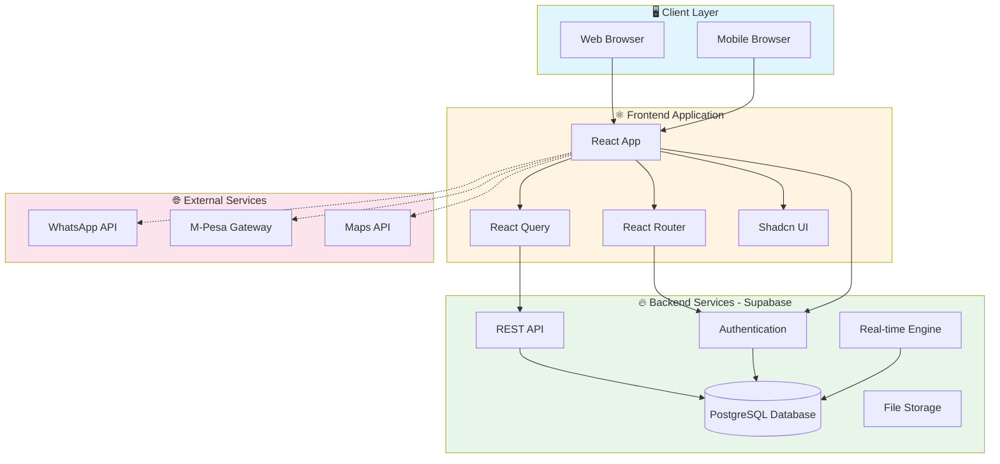
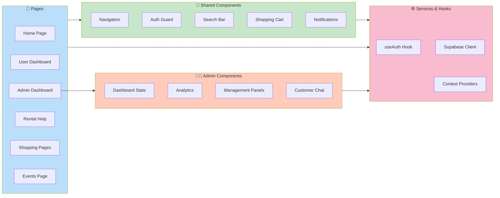
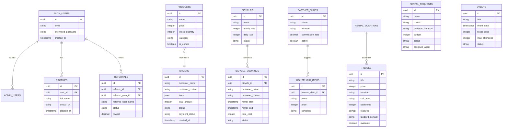
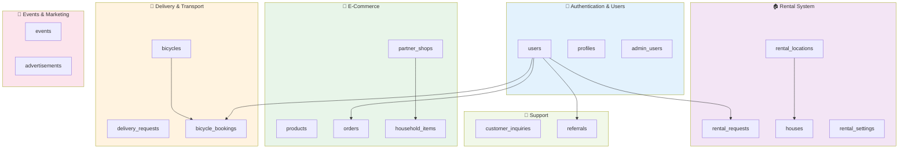
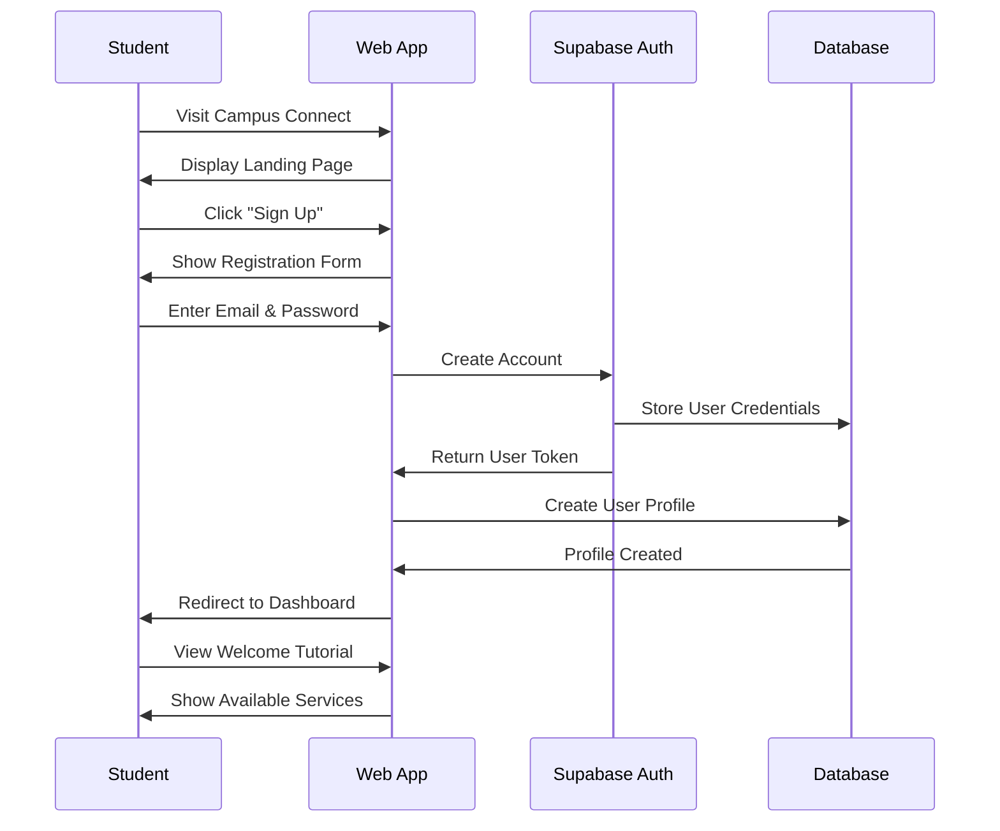
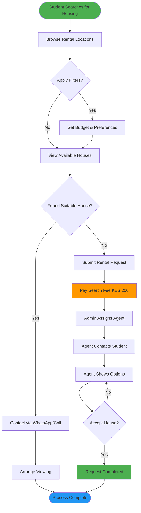
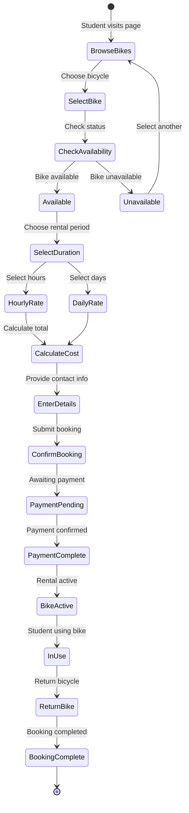
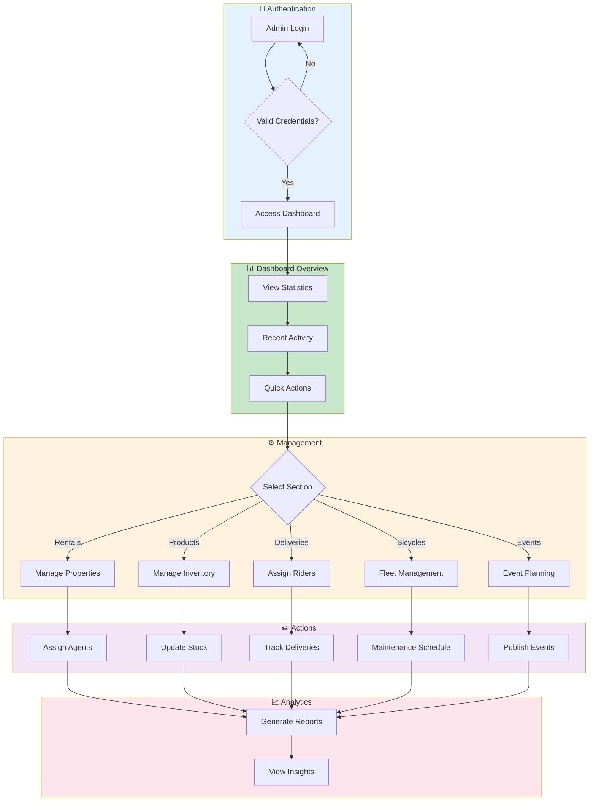

# 🎓 Campus Connect - Your Ultimate Student Companion

<div align="center">


**🚀 Empowering Student Life with Smart Solutions**

[](https://lovable.dev)
[](https://reactjs.org/)
[](https://www.typescriptlang.org/)
[](https://supabase.com/)
[](https://tailwindcss.com/)

</div>

## 🌟 Welcome to Campus Connect!

Campus Connect is your **all-in-one digital companion** designed specifically for students! 🎒 Whether you're looking for accommodation, need study materials, want to rent a bicycle, or searching for campus events - we've got you covered! 

### ✨ What Makes Us Special?

🏠 **Smart Rental Solutions** - Find your perfect student accommodation  
🛒 **Nerdy Cart** - Get all your study essentials delivered  
📦 **Settle Box** - Household items for your new place  
🚚 **Lightning Delivery** - Fast delivery services across campus  
🚲 **Eco-Friendly Rides** - Bicycle rentals for sustainable transport  
🎉 **Campus Life** - Discover exciting events and opportunities  
💬 **24/7 Support** - Always here to help!

---

## 🚀 Quick Start Guide

### 📋 Prerequisites

Before you begin, ensure you have:
- 📱 **Node.js** (v18+ recommended)
- 📦 **npm** or **yarn** package manager
- 🌐 **Modern web browser**
- ☕ **A cup of coffee** (optional but recommended! ☕)

### ⚡ Installation

1. **Clone the repository**
   ```bash
   git clone <YOUR_GIT_URL>
   cd <YOUR_PROJECT_NAME>
   ```

2. **Install dependencies**
   ```bash
   npm install
   # or
   yarn install
   ```

3. **Start the development server**
   ```bash
   npm run dev
   # or
   yarn dev
   ```

4. **Open your browser** 🌐
   Navigate to `http://localhost:8080` and start exploring!

---

## 🏗️ Tech Stack

### 🎨 Frontend
- **⚛️ React 18.3.1** - Modern UI library
- **📘 TypeScript** - Type-safe development
- **🎨 Tailwind CSS** - Utility-first styling
- **🧩 Shadcn/UI** - Beautiful component library
- **🔄 React Router** - Client-side routing
- **📊 React Query** - Data fetching & caching

### 🔧 Backend & Database
- **🔥 Supabase** - Backend-as-a-Service
- **🗄️ PostgreSQL** - Robust database
- **🔐 Row Level Security** - Data protection
- **📡 Real-time subscriptions** - Live updates

### 🛠️ Development Tools
- **⚡ Vite** - Lightning-fast build tool
- **🔍 ESLint** - Code linting
- **💅 Prettier** - Code formatting
- **🚀 Lovable** - AI-powered development

---

## 📱 Features Overview

### 🏠 Rental Help
> **Find Your Perfect Student Home!** 🏡

- 🔍 **Smart Search** - Filter by location, budget, and preferences
- 📱 **WhatsApp Integration** - Direct contact with property agents
- 💰 **Budget Tracking** - Stay within your financial limits
- 📍 **Location-based Results** - Find homes near your campus

### 🛒 Nerdy Cart (Study Essentials)
> **Everything You Need for Academic Success!** 📚

- 📝 **Stationery & Supplies** - Pens, notebooks, highlighters
- 💻 **Tech Accessories** - Laptop stands, cables, chargers
- 📊 **Study Materials** - Reference books, guides, flashcards
- 🛍️ **Combo Deals** - Save money with bundled packages
- 🚚 **Express Delivery** - Get your items fast!

### 📦 Settle Box (Household Items)
> **Make Your Space Feel Like Home!** 🏠

- 🛏️ **Furniture** - Chairs, tables, storage solutions
- 🍳 **Kitchen Essentials** - Cookware, utensils, appliances
- 🧼 **Cleaning Supplies** - Keep your space spotless
- 🛋️ **Comfort Items** - Cushions, rugs, decorations
- 🏪 **Partner Shop Network** - Quality items from trusted vendors

### 🚚 Delivery Services
> **Fast & Reliable Campus Delivery!** 📦

- 🏃‍♂️ **Express Delivery** - Get items within hours
- 📍 **Campus-wide Coverage** - We deliver everywhere on campus
- 📱 **Real-time Tracking** - Know exactly where your package is
- 👨‍🚴 **Eco-friendly Options** - Bicycle delivery available

### 🚲 Bicycle Rentals
> **Sustainable Transportation for Students!** 🌱

- 🚴‍♀️ **Hourly & Daily Rates** - Flexible rental options
- 🔧 **Well-maintained Fleet** - Safe and reliable bikes
- 📱 **Easy Booking** - Reserve your bike in advance
- 🌍 **Eco-friendly Transport** - Reduce your carbon footprint

### 🎉 Campus Events
> **Never Miss the Fun!** 🎪

- 🎭 **Cultural Events** - Concerts, plays, art shows
- 🏆 **Sports Competitions** - Join or cheer for your team
- 📚 **Academic Workshops** - Skill-building sessions
- 🎟️ **Easy Ticket Booking** - Secure your spot instantly

### 💼 Advertisement Platform
> **Connect Businesses with Students!** 📢

- 🎯 **Targeted Advertising** - Reach the right audience
- 💰 **Flexible Pricing** - Options for every budget
- 📊 **Analytics Dashboard** - Track your ad performance
- 🕰️ **Scheduled Campaigns** - Plan your advertising strategy

---

## 👨‍💼 Admin Dashboard

### 🎛️ Comprehensive Management System

The admin dashboard provides complete control over all platform operations:

#### 📊 **Dashboard Analytics**
- 📈 Real-time statistics and metrics
- 💰 Revenue tracking and financial insights
- 👥 User engagement analytics
- 📱 Platform performance monitoring

#### 🏠 **Rental Management**
- 🏘️ Manage rental locations and properties
- 👨‍💼 Assign agents to rental requests
- 💵 Configure search fees and pricing
- 📋 Track rental request status

#### 🛒 **Product Management**
- ➕ Add/edit study essentials and household items
- 📦 Manage inventory and stock levels
- 🏪 Partner shop management
- 💰 Pricing and discount controls

#### 🚚 **Delivery Operations**
- 👨‍🚴 Assign delivery riders
- 📍 Route optimization and tracking
- 💰 Delivery fee management
- 📊 Performance analytics

#### 🚲 **Bicycle Fleet**
- ➕ Add/remove bicycles from fleet
- 🔧 Maintenance scheduling and tracking
- 💰 Rate management (hourly/daily)
- 📅 Booking management

#### 🎉 **Events & Advertising**
- 📅 Create and manage campus events
- 🎟️ Ticket sales and attendee management
- 📢 Advertisement approval and scheduling
- 💰 Revenue tracking

#### 💬 **Customer Support**
- 📧 Manage customer inquiries
- 💬 Real-time chat support
- 📊 Support ticket tracking
- 🎯 Response time analytics

---

## 🔐 Authentication & Security

### 🛡️ **Robust Security Features**

- 🔒 **Supabase Authentication** - Enterprise-grade security
- 🔑 **Row Level Security (RLS)** - Data protection at database level
- 👤 **User Profiles** - Secure user data management
- 🔄 **Session Management** - Automatic token refresh
- 📧 **Email Verification** - Secure account activation

### 🚪 **Sign-in Options**
- 📧 **Email & Password** - Traditional authentication
- 🔗 **Magic Links** - Passwordless authentication
- 🔒 **Secure Password Reset** - Safe account recovery

---

## 🗂️ Project Structure

```
src/
├── 📁 components/          # Reusable UI components
│   ├── 📁 admin/          # Admin dashboard components
│   └── 📁 ui/             # Base UI components (shadcn)
├── 📁 pages/              # Application pages/routes
├── 📁 hooks/              # Custom React hooks
├── 📁 integrations/       # External service integrations
│   └── 📁 supabase/       # Supabase configuration
├── 📁 lib/                # Utility functions
└── 📄 App.tsx             # Main application component
```

---

## 🌐 API Documentation

### 🔌 **Database Tables**

#### 👥 **User Management**
- `admin_users` - Admin user roles and permissions
- `customer_inquiries` - Customer support tickets

#### 🏠 **Rental System**
- `rental_requests` - Student accommodation requests
- `rental_locations` - Available rental locations
- `rental_settings` - Platform configuration

#### 🛒 **E-commerce**
- `products` - Study essentials and items
- `orders` - Customer purchase orders
- `household_items` - Settle Box inventory
- `partner_shops` - Vendor management

#### 🚚 **Delivery & Transport**
- `delivery_requests` - Delivery service requests
- `bicycles` - Bicycle fleet management
- `bicycle_bookings` - Rental reservations

#### 🎉 **Events & Marketing**
- `events` - Campus events and activities
- `advertisements` - Advertising campaigns

---

## 🏛️ System Architecture

### High-Level Architecture



### Component Architecture



---

## 🗄️ Database Schema

### Entity Relationship Diagram



### Database Tables Overview



---

## 🔄 User Flow Diagrams

### Student Registration & Onboarding



### Rental Request Flow



### Shopping & Delivery Flow

```mermaid
flowchart LR
    A[Browse Products] --> B{Product Type?}
    B -->|Study Essentials| C[Nerdy Cart]
    B -->|Household Items| D[Settle Box]
    
    C --> E[Add to Cart]
    D --> E
    
    E --> F[Review Cart]
    F --> G{Continue Shopping?}
    G -->|Yes| A
    G -->|No| H[Proceed to Checkout]
    
    H --> I[Enter Delivery Info]
    I --> J[Choose Payment Method]
    J --> K{Payment Method}
    
    K -->|M-Pesa| L[Enter Phone Number]
    K -->|Cash| M[Cash on Delivery]
    
    L --> N[Confirm Payment]
    M --> N
    
    N --> O[Order Confirmed]
    O --> P[Admin Assigns Rider]
    P --> Q[Delivery in Progress]
    Q --> R[Order Delivered]
    
    style A fill:#e3f2fd
    style E fill:#fff3e0
    style O fill:#c8e6c9
    style R fill:#4caf50
```



### Bicycle Rental Flow



### Admin Dashboard Workflow



---

## 🚀 Deployment

### 🌍 **Easy Deployment with Lovable**

1. **Connect to GitHub** 🔗
   - Click the GitHub button in Lovable
   - Authorize the Lovable GitHub App
   - Your code will be automatically synced

2. **Deploy to Production** 🚀
   - Click the "Publish" button in Lovable
   - Your app will be live instantly!

3. **Custom Domain** 🌐
   - Go to Project > Settings > Domains
   - Connect your custom domain
   - SSL certificate included automatically

### 🔧 **Environment Configuration**

The app uses Supabase for backend services. All configuration is handled automatically through the Lovable platform.

---

## 🤝 Contributing

We love contributions! Here's how you can help make Campus Connect even better:

### 🌟 **Ways to Contribute**
- 🐛 **Report Bugs** - Help us identify and fix issues
- 💡 **Suggest Features** - Share your brilliant ideas
- 📝 **Improve Documentation** - Make our docs even better
- 🎨 **Design Improvements** - Enhance the user experience

### 📋 **Contribution Guidelines**
1. 🍴 Fork the repository
2. 🌿 Create a feature branch (`git checkout -b feature/amazing-feature`)
3. 💾 Commit your changes (`git commit -m 'Add amazing feature'`)
4. 📤 Push to the branch (`git push origin feature/amazing-feature`)
5. 🔄 Open a Pull Request

---

## 📞 Support & Community

### 🆘 **Need Help?**

- 📚 **Documentation** - Check our comprehensive guides
- 💬 **Discord Community** - Join our active community
- 📧 **Email Support** - Reach out directly
- 🐛 **Issue Tracker** - Report bugs on GitHub

### 🌟 **Stay Connected**
- 🐦 Follow us on Twitter
- 📸 Instagram updates
- 💼 LinkedIn community
- 📺 YouTube tutorials

---

## 📜 License

This project is licensed under the MIT License - see the [LICENSE](LICENSE) file for details.

---

## 🙏 Acknowledgments

### 💝 **Special Thanks**

- 🎨 **Lovable Team** - For the amazing development platform
- 🔥 **Supabase** - For the powerful backend infrastructure
- ⚛️ **React Community** - For the incredible ecosystem
- 🎨 **Shadcn** - For the beautiful UI components
- 🌟 **Our Beta Testers** - For valuable feedback and support

---

<div align="center">

## 🚀 Ready to Transform Student Life?

**[🌟 Star this repo](https://github.com/yourusername/campus-connect)** • **[🔗 Live Demo](https://your-app.lovable.app)** • **[📚 Documentation](https://docs.your-app.com)**

---

### 💻 Built with ❤️ using [Lovable](https://lovable.dev)

**Campus Connect - Making Student Life Easier, One Click at a Time! 🎓✨**

</div>
```
